<p align="center">
  
</p>

<p align="center">
  
  
  
  
  
  
  
</p>

<p align="center">
  <a href="#-run-it-in-three-minutes">Run it</a> ·
  <a href="#-the-product">Product</a> ·
  <a href="#-the-one-rule">The one rule</a> ·
  <a href="#-architecture">Architecture</a> ·
  <a href="#-the-28-controls">Controls</a> ·
  <a href="#-compliance-graph">Compliance graph</a> ·
  <a href="#-sovereignty-map">Sovereignty map</a> ·
  <a href="#-agents">Agents</a> ·
  <a href="#-regula-connect-mcp--a2a">Connect</a> ·
  <a href="#-where-everything-comes-from">Sources</a> ·
  <a href="#-whats-real-and-whats-preview">Real vs preview</a>
</p>

---

**Regula** tells a company where it stands under the **EU AI Act**, the **GDPR** and its **data-sovereignty** exposure, and what to do next. It starts with a free scan of the company's public website, asks the questions only the company can answer, collects evidence, and runs a fixed catalogue of 28 legal controls over what it found.

Built in Athens at the **GenAI Summit Hackathon 2026** (theme: agentic AI).

| | |
|---|---|
| 🎬 **Demo video** (1 min) | <https://youtu.be/XWnAp8m0uV8> |
| 🌐 **Live demo** | <https://demo.100devs.ai/aidpo/> (free scan without sign-up) |
| ⚡ **Run locally** | `docker compose up --build` → <http://localhost:8090/>, sign in `user` / `user` ([below](#-run-it-in-three-minutes)) |
| 👥 **Team** | [below](#-team) |

**Who it is for:** EU small and mid-sized companies that use AI tools and hold personal data but have no full-time DPO, and the DPOs and lawyers who advise them.
**The problem:** the AI Act, the GDPR and US cloud exposure each come with duties; a company cannot tell which apply to it, where it stands, or what proof it has.
**The solution:** Regula scans the public website in a real browser, asks only what it cannot see, collects evidence, and a deterministic engine sets the status of 28 legal controls, each with its article, its evidence and the next action, signed off by a person.

> Regula is an aid for the DPO, the lawyer and the founder. It is **not legal advice and not a certification**. Every finding says what was observed, what is inferred, and what is still unknown.

## ⚡ Run it in three minutes

You need **Docker Desktop**, running.

```sh
git clone https://github.com/Athina87-search/genai-hackathon-2026.git
cd genai-hackathon-2026
cp .env.example .env          # add a GEMINI_API_KEY or the AZURE_OPENAI_* values, and AIDPO_ADMIN_PASSWORD
docker compose up --build
```

Open **<http://localhost:8090/>** and sign in with `user` / `user` (a Premium demo account bound to localhost only).

| Page | What you see |
|---|---|
| `/` → `/home/` | The public site. Type any URL in the hero: Regula opens it in a real browser and shows the scan live |
| `/discovery/` | The assessment: profile, sector, AI tools in use, uploads, website check |
| `/workspace/` | The 19-screen workspace (Know · Collect · Ask & connect · Account) |
| `/classic/` | The team's original UI, untouched. Set `AIDPO_HOME=classic` to make it the start page again |

The free website scan and the labelled mock audit work **without any model key**. The live URL audit, the DPO assessment and "Ask Regula" need a server-side model key (Gemini wins when `GEMINI_API_KEY` is set; otherwise Azure OpenAI). Keys are never sent to the browser. Greek setup guide: [SETUP.md](SETUP.md).

<details>
<summary><b>Without Docker</b> (macOS / Linux)</summary>

```sh
python3 -m venv .venv
.venv/bin/pip install fastapi "uvicorn[standard]" python-multipart openai==3.51.0 playwright==1.59.0 \
  beautifulsoup4 lxml openpyxl pydantic python-docx python-pptx pypdf==6.4.2 "a2a-sdk[fastapi]==1.3.0"
.venv/bin/python -m playwright install chromium
cd aidpo/web && npm ci && NEXT_PUBLIC_BASE= npm run build && cd ..
export GEMINI_API_KEY=...  AIDPO_SECURE_COOKIE=0          # or the four AZURE_OPENAI_* variables
../.venv/bin/python server.py adduser me YourPassword --premium
../.venv/bin/python refresh_law.py                        # first download of the legal texts
../.venv/bin/python -m uvicorn server:app --port 8090
```
</details>

## 🧭 The product

<p align="center"></p>

| Step | Where | What happens |
|---|---|---|
| **1. Scan** | `/home/` hero | A real Chromium opens the site twice (before and after consent), records every request, finds the banner and the Reject button, checks policies, AI-chatbot disclosure (AI Act Art. 50), headers and accessibility. Score A–F, findings with legal reference and fix, PDF, and a world map of where the visit went |
| **2. Discover** | `/discovery/` | Profile, sector (ΚΑΔ), AI tools seen in use, card uploads, a talk box. Answers save in the browser and, once signed in, to the account |
| **3. Know** | Workspace → Know | Overview, Findings, Actions, Reports, Run, Agent runs, Sovereignty map, Your sector, Compliance Graph, Inspection letter |
| **4. Collect** | Workspace → Collect | AI systems (with the AI Act classifier), Evidence (with the evidence hunter), Office PCs, Sources |
| **5. Ask & connect** | Workspace → Ask & connect | Ask Regula, Connect your AI assistant over MCP, Watch the law change |
| **6. Hand over** | Reports | Readiness report (`.docx`), findings sheet and record of processing (`.xlsx`), the simulated inspection letter (`.docx`), DPO report & deck |

## 🧱 The one rule

<p align="center"></p>

Everything in Regula hangs on one design decision: **agents and models gather and explain; a deterministic engine decides.**

- Every source writes **facts** (`key`, `value`, `source`, `strength`, `time`). There are two strengths: `direct` (Regula saw it) and `tenant_supplied` (the company says so).
- `audit/engine.py` evaluates each control against the facts. Same facts in, same findings out.
- Anything that is not `direct` is **capped at `partial`**. A company's own statement can never make a control `met` on its own.
- Every output (reports, chat, MCP, A2A, inspection letter, Watch) **reads findings**. None of them can write one.

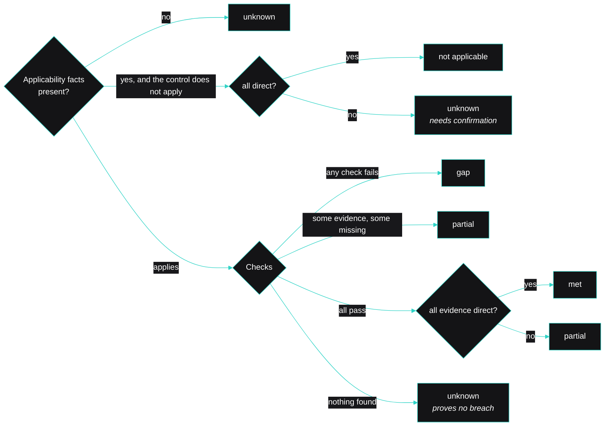

## 🏗 Architecture

<p align="center"></p>

One FastAPI process (`aidpo/server.py`) serves the static Next.js UI, the APIs, the MCP connector and the A2A services. New capabilities live in **feature packages** under `aidpo/features/` and are mounted by `features.mount_all(app)`; `GET /api/features` lists them and `AIDPO_FEATURES_OFF=name,name` switches any of them off. Every model call goes through `aidpo/model_provider.py`.

The live scan on the home page, end to end:

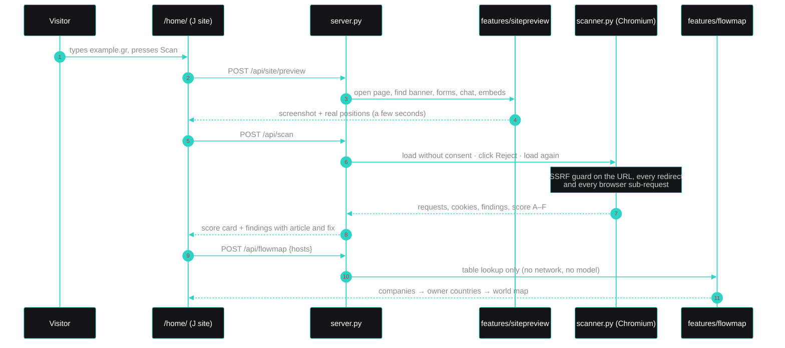

## 📋 The 28 controls

The control catalogue is versioned (`2026-11-14.1`) and lives in `aidpo/audit/controls.py`. Each control names the facts it needs, its applicability, its severity, its owner and the action that closes it. The engine checks **56 fact keys**.

<details open>
<summary><b>A · AI Act (9) · B · GDPR & e-privacy (16) · C · Exposure (2) · I · Infrastructure (1)</b></summary>

| ID | Requirement | Legal basis | Severity | Owner |
|---|---|---|---|---|
| `A1` | Complete and current AI inventory | AI Act Arts 4, 26 | 🟠 high | DPO / IT |
| `A2` | No prohibited AI practice | AI Act Art. 5 | 🔴 critical | DPO |
| `A3` | High-risk AI uses identified and classified | AI Act Art. 6 · Annexes I, III | 🟠 high | DPO / AI owner |
| `A4` | High-risk deployer duties: oversight, logs and worker notice | AI Act Art. 26 | 🟠 high | AI owner / HR |
| `A5` | FRIA completed where Article 27 applies | AI Act Art. 27 | 🟠 high | DPO |
| `A6` | People are informed when they interact with AI | AI Act Art. 50 | 🟠 high | Product owner |
| `A7` | AI literacy measures for staff | AI Act Art. 4 | 🟡 medium | HR / DPO |
| `A8` | No unapproved shadow AI | AI Act Art. 4 · GDPR Arts 28, 32 | 🟠 high | IT / DPO |
| `A9` | Implementation roadmap uses current application dates | AI Act Art. 113 (as in force) | 🟡 medium | DPO |
| `B1` | Records of processing cover all processing | GDPR Art. 30 | 🟠 high | DPO |
| `B2` | Lawful basis documented for each processing activity | GDPR Arts 6, 7 | 🟠 high | DPO |
| `B3` | Special-category data has Article 9 basis and restricted access | GDPR Arts 9, 32 | 🔴 critical | DPO / Security |
| `B4` | Privacy notices cover customers, workers and candidates | GDPR Arts 12–14 | 🟠 high | DPO |
| `B5` | Data-subject requests are tracked and answered on time | GDPR Art. 12(3), 15–22 | 🟠 high | DPO |
| `B6` | Automated decisions include required human review and safeguards | GDPR Art. 22 | 🔴 critical | DPO / Process owner |
| `B7` | Every processor is inventoried and covered by an Article 28 DPA | GDPR Art. 28 | 🟠 high | DPO / Procurement |
| `B8` | International transfers have a valid mechanism and assessment | GDPR Arts 44–49 | 🟠 high | DPO / Legal |
| `B9` | Appropriate technical and organisational security | GDPR Art. 32 | 🔴 critical | Security / IT |
| `B10` | Privacy by design and minimisation | GDPR Art. 25 | 🟠 high | Product / DPO |
| `B11` | DPIA completed for high-risk processing | GDPR Art. 35 | 🟠 high | DPO |
| `B12` | DPO appointed and reachable where required | GDPR Arts 37–39 | 🟠 high | Management |
| `B13` | Breach register and 72-hour decision procedure | GDPR Arts 33–34 | 🔴 critical | DPO / Security |
| `B14` | Retention schedule is implemented and deletion is evidenced | GDPR Art. 5(1)(e) | 🟠 high | DPO / IT |
| `B15` | Cookies and marketing consent work correctly | Law 3471/2006 Art. 4(5) · GDPR Art. 7 | 🟠 high | Marketing / DPO |
| `B16` | CCTV has notice, purpose and proportionate retention | HDPA Directive 1/2011 · GDPR Art. 5 | 🟠 high | DPO / Facilities |
| `C1` | No publicly shared files containing sensitive personal data | GDPR Arts 5, 9, 32 | 🔴 critical | Security / DPO |
| `C2` | No secrets committed to source repositories | GDPR Art. 32 | 🔴 critical | Engineering / Security |
| `I1` | Linux servers follow a minimum secure baseline | GDPR Art. 32 · CIS baseline | 🟠 high | IT / Security |
</details>

## 🕸 Compliance graph

<p align="center"></p>

The graph is Regula's ontology made visible (workspace → Know → **Compliance Graph**). View 1 is the model above, with live counts. View 2 draws the signed-in company's own controls, coloured by status. It is read-only: it composes data the workspace already loaded, plus `GET /api/features`, `GET /api/law-status` and `GET /api/sovereignty/map`.

## 🌍 Sovereignty map

<p align="center"></p>

Two places in the product use this data:

- **On the public scan result**: "Where this visit went". Every third-party host the visit reached is grouped into a company and drawn to the country where that company is owned (`POST /api/flowmap`, a pure table lookup).
- **In the workspace** (Know → **Sovereignty map**): the vendor agent looks up the company's dependencies and records owner and country, or marks them *unknown* (`GET /api/sovereignty/map`).

Countries are classed **only** from the European Commission's adequacy list (`eu_eea`, `adequacy` with its condition, `other`); never by a model. Of the 66 vendors in the table, 51 are owned in a country with an adequacy decision (45 of them in the US, valid only for companies in the EU-US Data Privacy Framework), 13 in the EU/EEA and 2 in a third country.

## 🤖 Agents

<p align="center"></p>

| Team | Agents | Bounded by |
|---|---|---|
| **Website** | Website Audit Agent + five specialists (Consent, Legal Counsel, DPO Advisor, Risk Analyst, Auditor's Eye) | Must call the real `scan_website` tool; specialists read the same scan and have their own daily budget |
| **Legal brain** | Legal Question Agent, DPO Assessment, Synthesis Agent | Pydantic output schemas; cite an article for every claim; the synthesis agent cannot change a status |
| **Company audit (A2A)** | EU Market Access, GDPR & Data Transfer, AI Act, Technical Evidence | Four independent A2A services with agent cards and bearer auth; read-only normalized evidence tools; visible tool trace |
| **Workers (job feed)** | Evidence Hunter (12 steps · 8 pages · 60 s), Vendor Agent (12 steps · 90 s), Drafter (8 steps · ≤ 2 revisions), AI Act Classifier (6 steps · 60 s), Watch (6 steps · 30 s) | `features/jobs` runtime: one running job per tenant per kind, step and time limits, every event is one plain sentence |

Every worker runs as a **job** and reports through the job feed, which is what the *Run* and *Agent runs* screens draw:

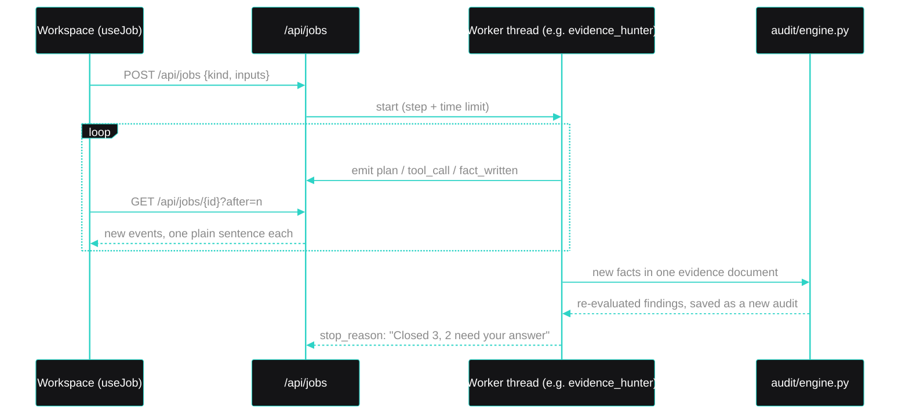

The four company agents talk over the official **A2A** protocol:

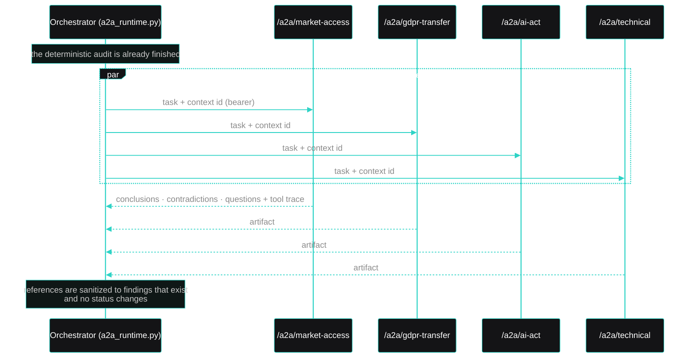

## 🔌 Regula Connect (MCP + A2A)

<p align="center"></p>

Workspace → **Connect** creates a personal URL. Paste it into your assistant:

```sh
# Claude Code
claude mcp add --transport http regula https://<your-regula-host>/mcp/v2/<token>
```

- **Claude / claude.ai**: Settings → Connectors → *Add custom connector* → paste the URL.
- **ChatGPT, Cursor, VS Code**: add a custom / HTTP MCP server with the same URL.
- Locally the URL is `http://localhost:8090/mcp/...`; assistants on the internet need the public HTTPS deployment or a tunnel.

`/mcp/{token}` (v1) serves 5 company tools plus the 7 law tools of the Q&A agent. `/mcp/v2/{token}` serves all of those plus 7 read-only tools for findings, Discovery, the AI systems, the vendor map and agent runs. `propose_fix` prepares a review artifact; **nothing over MCP can approve or apply a change**.

## 📚 Where everything comes from

<p align="center"></p>

| Source | Used for | Where in the repo |
|---|---|---|
| [AI Act, Regulation (EU) 2024/1689](https://eur-lex.europa.eu/legal-content/EL/TXT/?uri=CELEX:32024R1689) | Controls A1–A9, classifier, Watch (Art. 113) | `aidpo/law/32024R1689.ell.html` |
| [GDPR, Regulation (EU) 2016/679](https://eur-lex.europa.eu/legal-content/EL/TXT/?uri=CELEX:32016R0679) | Controls B1–B16 (with Greek law for B15, B16), C1–C2, I1 | `aidpo/law/32016R0679.ell.html` |
| [Regulation (EU) 2026/1744](https://eur-lex.europa.eu/legal-content/EL/TXT/?uri=CELEX:32026R1744) amending the AI Act | Watch: the new application dates | refreshed daily |
| NIS2, Cyber Resilience Act, Data Act, EHDS, MDR, IVDR, Clinical Trials, Medicinal Products Code, GMP, Product Liability | Sector rules and the legal Q&A | `refresh_law.py` → `LEGISLATION` |
| [EDPB publications](https://www.edpb.europa.eu/feed/publications_en) (RSS) | Non-binding guidance in retrieval | `law/guidance.json` |
| [Hellenic DPA press releases](https://www.dpa.gr/el/enimerwtiko/deltia) | Non-binding guidance; HDPA Directive 1/2011 (CCTV, B16) | `law/guidance.json`, controls |
| [AI Act Service Desk FAQ](https://ai-act-service-desk.ec.europa.eu/en/faq) (European Commission) | Non-binding guidance | `law/guidance.json` |
| Law 3471/2006 (Greek e-privacy) | Cookies and marketing consent (B15) | `audit/controls.py` |
| [Commission adequacy decisions](https://commission.europa.eu/law/law-topic/data-protection/international-dimension-data-protection/adequacy-decisions_en) | Country classes (57 countries, as of 15 Nov 2026) | `features/vendors/jurisdictions.json` |
| Each vendor's own privacy or legal page | Owner entity and country of 66 vendors | `features/vendors/vendors.json` |
| [Digital Omnibus on AI, new dates](https://www.dataprotectionreport.com/2026/07/the-eu-ai-act-when-does-it-become-enforceable-now/) | Watch replay (old dates read from Art. 113 in the corpus) | `features/watch/change.json` |
| GDPR Art. 83 & AI Act Art. 99 fine tiers ([EUR-Lex](https://eur-lex.europa.eu/eli/reg/2016/679/oj/eng)) | Illustrative exposure range, never a prediction | `audit/exposure.py` |
| [Natural Earth](https://www.naturalearthdata.com/) 110m land (public domain) | World map outline | `web/app/_site/worldmap.js` |

How the legal corpus stays current:

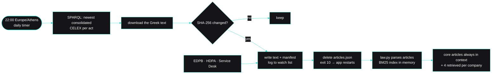

Retrieval is lexical (**BM25**, no embeddings, nothing leaves the server), with Greek normalisation: lower case, accents removed, final ς → σ, a rough six-letter stem. Guidance is always shown to the model as non-binding with its URL.

## 🔐 Security and privacy by design

- **The scanner cannot be turned on you**: protocols and ports are restricted, and private, loopback, link-local, reserved and cloud-metadata addresses are rejected on the URL, every redirect and every browser sub-request.
- **Uploads keep facts, not files**: 2 MB limit and an allowlist; raw bytes are discarded after parsing; only normalized facts, metadata and a SHA-256 stay.
- **Sessions**: HMAC-signed cookie, session-bound CSRF tokens, reviewer and admin roles, PBKDF2-SHA256 (200k iterations), per-IP rate limits.
- **Tenants**: audits, evidence, reviews and Discovery answers are scoped to the owner; MCP tools read only the tenant that owns the token.
- **Remediation is proposal-only**: approval is stored separately and never grants production write, merge, deploy, contract signing or unrestricted SSH.
- **No invented law**: a citation that is not found in the stored corpus is dropped; a tier without an anchor article is not offered.

## 🗂 Repository layout

```text
.
├── aidpo/                     ← the product (REGULA)
│   ├── server.py              FastAPI app: routes, auth, page serving
│   ├── model_provider.py      the single model configuration (Gemini or Azure OpenAI)
│   ├── scanner.py             Playwright website scan
│   ├── dpo.py · report.py     DPO assessment and Word / PowerPoint / RoPA exports
│   ├── law.py · refresh_law.py  legal corpus, BM25, daily refresh
│   ├── tools.py · mcp_server.py Q&A agent tools and REGULA Connect v1
│   ├── specialists.py         five website specialist personas
│   ├── kad.py · classify.py   sectors (ΚΑΔ), questions, retention · personal-data column classifier
│   ├── endpoint.py            PC agents (Windows / macOS)
│   ├── audit/                 engine, 28 controls, evidence store, A2A agents, website agent, exposure, remediation
│   ├── features/              14 plug-in packages (see below)
│   ├── law/                   official texts and the parsed article cache
│   └── web/app/               Next.js 15 UI
│       ├── _site/             direction J public site (home, how, integrations)
│       ├── _regula/           workspace shell, screens/, i18n (EL/EN), job feed
│       ├── discovery/ · workspace/   page entries
│       └── page.jsx           the original UI, served at /classic/
├── tests/                     27 test files (321 tests)
├── docs/readme/               the diagrams in this README
├── scripts/                   setup and surgical deploy
└── src/agent/                 the hackathon agent scaffold (private "brain")
```

<details>
<summary><b>The 14 feature packages</b></summary>

| Package | What it adds | Routes |
|---|---|---|
| `jobs` | Agent job runtime and feed | `POST /api/jobs`, `GET /api/jobs/{id}?after=`, `GET /api/jobs/kinds` |
| `hunter` | Evidence hunter | `GET /api/hunter/targets` + job `evidence_hunter` |
| `vendors` | Vendor agent, vendor & jurisdiction tables | `GET /api/sovereignty/map` + job `vendor_agent` |
| `flowmap` | "Where this visit went" | `POST /api/flowmap` |
| `sitepreview` | Early picture and real positions on the scan stage | `POST /api/site/preview` |
| `drafter` | Drafter with self-check | `GET /api/drafter/plan`, `GET /api/drafts[/{id}[/download.docx]]` + job `drafter` |
| `classifier` | AI Act classifier (preview) | `GET /api/classifier/results`, `POST /api/classifier/confirm` + job `classifier` |
| `watch` | Replay of a real law change | `GET /api/watch/change` + job `watch_replay` |
| `reports` | Readiness report, findings sheet, RoPA | `GET /api/reports/{id}/readiness.docx`, `…/findings.xlsx`, `GET /api/reports/ropa.xlsx` |
| `inspection` | Simulated inspection letter | `GET /api/inspection/{audit_id}[/letter.docx]` |
| `sectors` | What the law asks of a sector | `GET /api/sectors[/match\|/{key}]`, `GET /api/account/connections` |
| `samplerun` | The sample company audit, step by step | `GET /api/samplerun/scenarios` + job `sample_run` |
| `discovery_state` | Discovery answers on the server | `GET/PUT /api/discovery/state` |
| `connector` | MCP v2 | `GET/POST /mcp/v2/{token}` |

**Adding one:** create `aidpo/features/<name>/` with an `__init__.py` docstring and a `routes.py` exposing `router`; it is mounted automatically. Register background work with `features.jobs.register(kind, run, …)` and write facts, never statuses.
</details>

<details>
<summary><b>Core API</b></summary>

| Method | Route | Purpose |
|---|---|---|
| `POST` | `/api/scan` · `GET /api/scan/{sid}` · `POST /api/scan/{sid}/pdf` | Public website scan |
| `POST` | `/api/assess` · `/api/v1/assess` (bearer) | DPO assessment; downloads at `/api/assess/{id}/report.docx`, `deck.pptx`, `ropa.xlsx` |
| `POST` | `/api/audit/mock` | Safe mock audit (no model) |
| `POST` | `/api/audit/website` | Live website agent over a public URL |
| `POST` | `/api/audit/company` | Four live A2A agents over the fictional company workspace |
| `POST` | `/api/evidence/upload` · `GET /api/evidence` · `POST /api/audit/evidence` | Tenant evidence |
| `POST` | `/api/audit/{id}/review` | Version-bound human review |
| `GET` | `/api/audit/{id}/remediations` · `POST …/{proposal}/review` | Proposal-only fixes |
| `POST` | `/api/audit/{id}/exposure` | Sourced, illustrative exposure range |
| `GET` | `/api/audits` · `/api/audit/{id}` · `/api/audit/controls` | Audits and the control catalogue |
| `POST` | `/api/agent` · `GET /api/agent/tools` | Legal Q&A agent |
| `GET` | `/api/law-status` · `/api/model-status` · `/api/features` | Health of the corpus, the model and the features |
| `GET` | `/.well-known/agent.json` · `/a2a/{name}/.well-known/agent-card.json` | Agent discovery |

Full request flows, storage and configuration: [aidpo/ARCHITECTURE.md](aidpo/ARCHITECTURE.md).
</details>

## 🧪 What's real and what's preview

Being precise about this is part of the product.

| Real and working | Preview or simulated |
|---|---|
| Website scan in a real browser, score, findings, PDF, world map | Company connectors (Drive, Gmail, Slack, GitHub, AWS, database, SSH) run on **fictional fixtures** (`aegean_clinic`, `shenzhen_recruit_ai`, `yulian_beauty`) |
| The deterministic engine and its 28 controls | Free-form PDF / DOCX uploads produce no facts until a person reviews them |
| Legal corpus with daily refresh, BM25 retrieval, citation checks | The AI Act classifier is marked **Preview**; nothing is written until the user confirms |
| Four A2A specialists on the official SDK with tool traces | Watch replays **one** real change (the Digital Omnibus dates) |
| Evidence hunter, vendor agent, drafter, job feed | The inspection letter is a simulation built from the company's own findings |
| MCP v1 and v2, reports, inspection letter export | The jurisdiction table needs a lawyer's review before anyone relies on it |

## 🛠 Development

```sh
pip install pytest httpx python -m pytest -q tests          # 321 testspython -m pytest -q tests          # 321 tests python -m pytest -q tests   # 321 tests (verified in the Docker image)
cd aidpo/web && npm ci && npm run build      # base path /aidpo (production)
NEXT_PUBLIC_BASE= npm run build              # base path / (Docker, local)
```

**Team workflow:** branch → pull request → merge → `scripts/deploy-aidpo.sh <sha>` for the server. Never push to `main`, never `rsync` to the server, never commit keys or `.env`. Details: [CONTRIBUTING.md](CONTRIBUTING.md).

**The hackathon agent scaffold** (separate from Regula) loads its rules, prompts, skills and memory at runtime from a private "brain" (`src/agent/brain.py`); without access it runs with the public `rules.example.md`:

```sh
./scripts/setup.sh
python3 -m src.agent.brain
```

## 👥 Team

Built at the GenAI Summit Hackathon 2026 in Athens by **1+team**: **Athina Feleki** ([@Athina87-search](https://github.com/Athina87-search)), **Margarita Varla** ([@MargaritaV33](https://github.com/MargaritaV33)), **Raldi Komini** ([@RaldiKomini](https://github.com/RaldiKomini)), **Aggelos Ladas** ([@AggelosLadas](https://github.com/AggelosLadas)) and **Maria Mitropoulou** ([@mmitropoulou](https://github.com/mmitropoulou)), with **Alfred**, our AI coding agent.

## ⏱ Built during the hackathon

All of this was written at the event. The repository was created on **Saturday 14 November 2026 at 12:10** (Athens) as an empty scaffold; the first Regula code landed at **17:21** that day, and everything after came through **40 merged pull requests** (123 commits) up to the Sunday 18:00 code freeze. The full history is in the [commit log](https://github.com/Athina87-search/genai-hackathon-2026/commits/main) and the [pull requests](https://github.com/Athina87-search/genai-hackathon-2026/pulls?q=is%3Apr+is%3Amerged).

What we used, not wrote: public libraries (FastAPI, Next.js, Playwright, the A2A SDK), the official EU legal texts from the Publications Office, and the public sources listed [above](#-where-everything-comes-from).

---

<p align="center"><sub>REGULA · an aid, not legal advice or a certification · confirm every result with your DPO or lawyer</sub></p>

<p align="center"><sub>© 2026 100devs.ai · All rights reserved · see <a href="LICENSE">LICENSE</a></sub></p>
